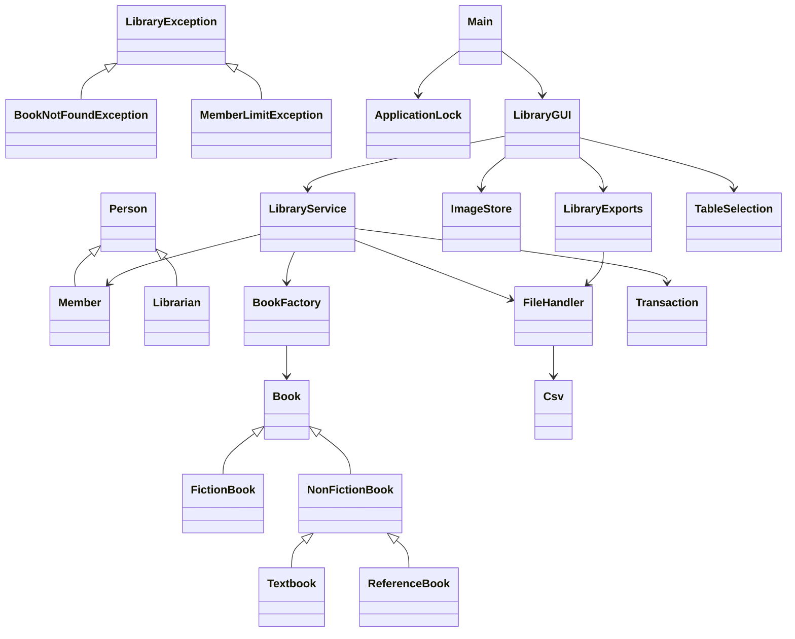

# Library System architecture

BookFactory instantiates and parses typed books. The GUI delegates record changes and circulation to LibraryService. FileHandler persists a complete versioned snapshot; it is not a singleton. ApplicationLock restricts the desktop entry point to one writer per data directory. ImageStore validates and normalizes image files separately from record saves.

Librarian is retained as a model class from the original academic OOP design. It is not a staff-login or authorization feature.
